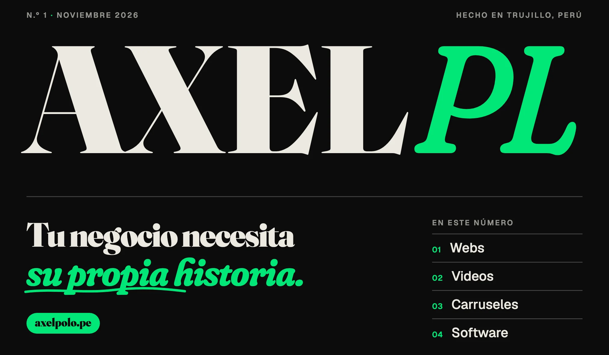
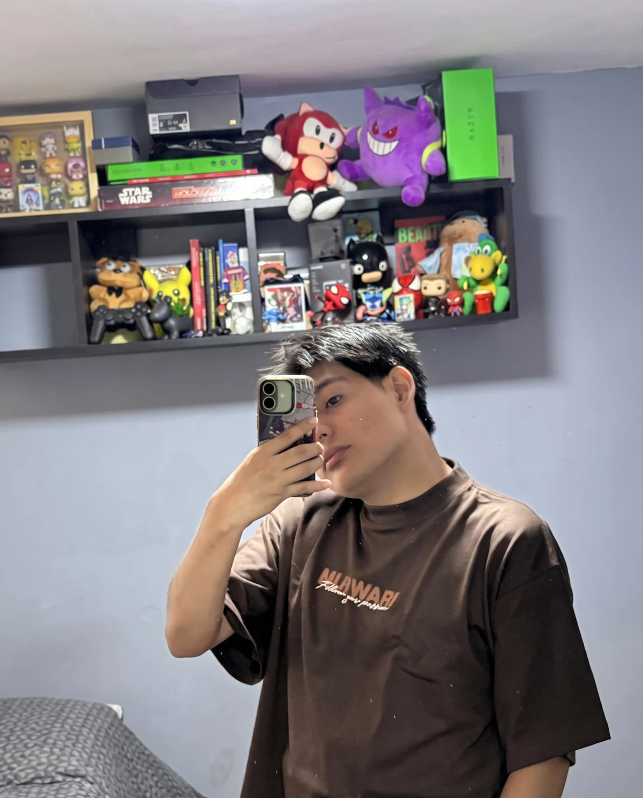
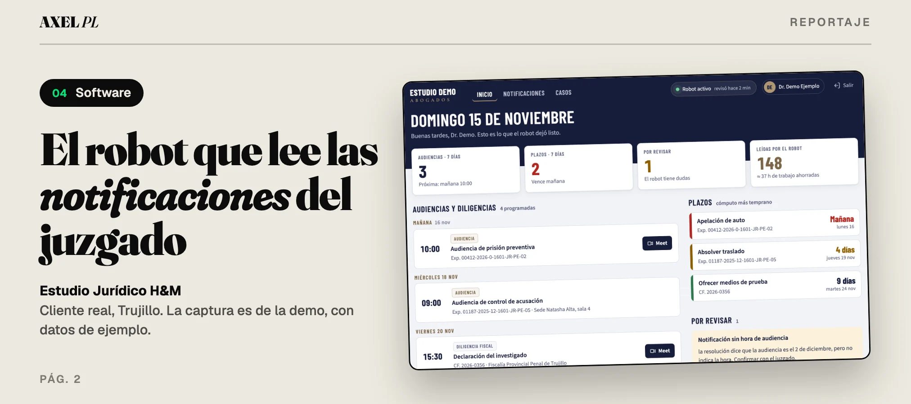
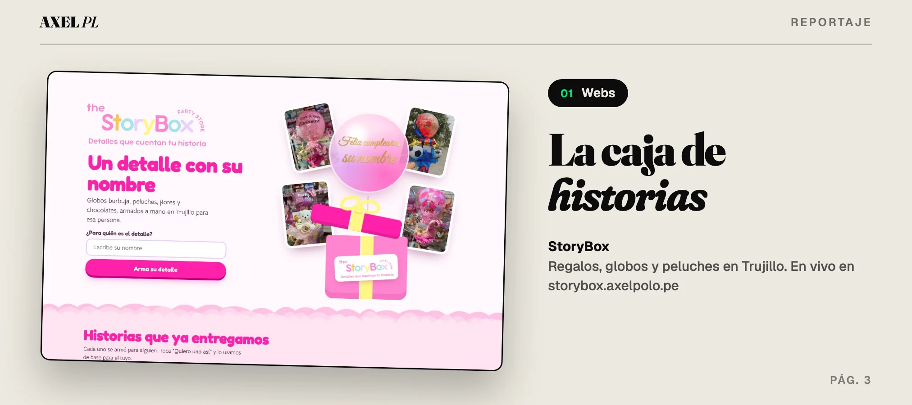
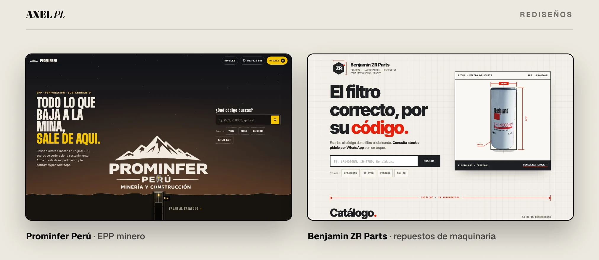

**Editorial.** Soy Axel Polo, de Trujillo, y estudio Sistemas e IA en la UPAO. Desde octubre de 2026 trabajo por mi cuenta con negocios de la ciudad: webs, videos, carruseles y sistemas. Este perfil es el número 1 de mi revista. Adentro va lo que ya salió.

[axelpolo.pe](https://axelpolo.pe) · [WhatsApp](https://wa.me/51960561541) · [Instagram](https://www.instagram.com/axxl.pl)

<i>En la foto: el autor, en su cuarto de Trujillo, donde se arma cada número.</i>
 

 

Un robot en Python revisa cada 5 minutos las notificaciones judiciales del estudio (SINOE, fiscalías y juzgados), saca el texto de los PDF con OCR y agenda cada audiencia en Google Calendar con su Meet. Los abogados lo ven todo en un panel web. El código es privado porque trabaja con casos reales.

[Ver la demo](https://robot-legal.axelpolo.pe)

 

La web de StoryBox, una tienda de arreglos de regalo, globos y peluches. Pones el nombre de la persona, armas el detalle y el pedido sale por WhatsApp.

[Ver la web](https://storybox.axelpolo.pe) · [Código](https://github.com/gottizz/storybox)

 

Dos propuestas de catálogo para negocios que venden por código de producto: lo buscas, lo encuentras y cotizas por WhatsApp. Todavía no están publicadas.

 

### Notas breves

- [rufino-lab](https://github.com/gottizz/rufino-lab): web para una marca de alitas de Trujillo.
- [botica-sophia-agentic](https://github.com/gottizz/botica-sophia-agentic): sistema multiagente de abastecimiento para una botica, con LangGraph, Groq y FastAPI. Tiene 118 pruebas.
- [api-reciclaje-edge](https://github.com/gottizz/api-reciclaje-edge): API que clasifica residuos reciclables a partir de una foto.
- [agile-prestamos-completo](https://github.com/gottizz/agile-prestamos-completo): gestión de préstamos y cobranzas con Node.js y Firebase.

Los tres últimos son de la universidad y de práctica.

<b>Colofón.</b> Trabajo con Python, HTML, CSS, JavaScript, Docker y Git, apoyándome en Claude Code. Todo corre en mi propio VPS con Linux (Contabo + EasyPanel).

 

